# Import et activation des utilisateurs

Diagramme du parcours d'import par le CRON via [userImport.ts](./userImport.ts), puis d'activation du compte.

Les affectations `user.role = …` et `account.status = …` apparaissent dans les cases uniquement lors de leur initialisation ou modification. `user.role` désigne ici le rôle du compte (stocké dans `account.role`).

```mermaid
flowchart TD
    subgraph Import["1. Import FTP"]
        FTP["Normaliser l'email, l'environnement et la formation"]
        Eligible{"Compte nouveau ou IMPORTED ?"}
        Target{"Identifiant d'entreprise disponible ?"}
        Members{"L'organisation cible a-t-elle des membres actifs ?"}
        Link["Rattacher le compte sans modifier les données de l'organisation"]
        Sync["Créer ou synchroniser l'organisation et rattacher le compte"]
        Keep["Conserver l'organisation et le rattachement du compte"]
        Save["Créer le compte ou actualiser les données personnelles et de formation<br/>Si nouveau : user.role = DEFAULT<br/>Si nouveau : account.status = IMPORTED"]
        FTP --> Eligible
        Eligible -->|Non| Keep
        Eligible -->|Oui| Target
        Target -->|Non| Keep
        Target -->|Oui| Members
        Members -->|Oui| Link
        Members -->|Non| Sync
        Keep --> Save
        Link --> Save
        Sync --> Save
    end
    subgraph Activation["2. Demande d'activation par l'utilisateur"]
        Request["Vérifier le compte, l'organisation et la licence BC"]
        Approval{"Des membres actifs et un compte pas encore VALIDATED ?"}
        Pending["Notifier les administrateurs et gestionnaires actifs<br/>account.status = PENDING_REQUEST"]
        Approved["Un responsable valide le compte<br/>user.role = rôle choisi par le responsable<br/>account.status = VALIDATED"]
        Reserve["Vérifier la réservation de 24 h ; bloquer si une autre activation est en cours"]
        Validated["Réserver l'organisation pendant 24 h<br/>account.status = VALIDATED"]
        Email["Envoyer le lien d'activation"]
        Password["Vérifier le lien et le mot de passe, puis finaliser l'activation<br/>account.status = ACTIVE"]
        Environment{"Environnement ?"}
        Tilt{"À la finalisation : premier membre avec le rôle DEFAULT ?"}
        TiltRole["Attribuer le rôle à l'activation<br/>user.role = ADMIN si formé, sinon GESTIONNAIRE"]
        Existing["Conserver le rôle"]
        BC{"Organisation pas encore passée par l'onboarding ?"}
        BCRole["Attribuer le rôle à l'ouverture de l'onboarding<br/>user.role = ADMIN si formé, sinon GESTIONNAIRE"]
        Request --> Approval
        Approval -->|Oui| Pending --> Approved --> Email
        Approval -->|Non| Reserve --> Validated --> Email
        Email --> Password --> Environment
        Environment -->|TILT| Tilt
        Environment -->|BC| BC
        Tilt -->|Oui| TiltRole
        Tilt -->|Non| Existing
        BC -->|Oui| BCRole
        BC -->|Non| Existing
    end
    Save -. Action de l'utilisateur .-> Request
```

### Scripts lancés par CRON

The user import runs every 10 minutes for BC and TILT. It updates personal and training data without changing existing account roles or statuses. New accounts are `IMPORTED` with the `DEFAULT` role.

Only new or `IMPORTED` accounts can be linked to an organization. Accounts already `VALIDATED`, `PENDING_REQUEST` or `ACTIVE` keep their organization. If the target organization has active members, the import links the account without updating organization data. Otherwise, it creates or synchronizes the organization; existing organization names are preserved.

Activation requires an organization and, for BC, a license. An account joining an active organization must be approved by an active administrator or manager, unless it is already `VALIDATED`. Direct activation reserves the organization for 24 hours and sends a link valid for 24 hours. Ordinary password-reset links remain valid for one hour.

When the password is set, the account becomes `ACTIVE`. The first TILT account with the `DEFAULT` role receives `ADMIN` if trained, or `GESTIONNAIRE` otherwise; explicitly assigned roles and roles in organizations with active members are preserved. BC keeps its existing role assignment during onboarding. Existing active TILT accounts are not migrated.
