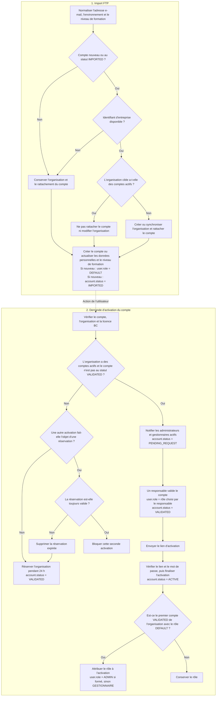

# Import et activation des utilisateurs

### Scripts lancés par CRON

L'import des utilisateurs s'exécute toutes les 10 minutes pour BC et TILT. Il met à jour les données personnelles et le niveau de formation, sans enregistrer les détails de la formation ni modifier le rôle ou le statut des comptes existants. Les nouveaux comptes ont le statut `IMPORTED` et le rôle `DEFAULT`.

Seuls les nouveaux comptes ou ceux au statut `IMPORTED` peuvent être rattachés à une organisation. Les comptes déjà au statut `VALIDATED`, `PENDING_REQUEST` ou `ACTIVE` conservent leur organisation. Si l'organisation cible a des comptes actifs, l'import ne rattache pas le compte et ne modifie pas l'organisation. Si elle n'en a pas, l'import crée ou synchronise l'organisation et y rattache le compte; le nom d'une organisation existante est conservé.

L'activation nécessite une organisation et, pour BC, une licence. Un compte qui rejoint une organisation ayant déjà des comptes actifs doit être approuvé par un administrateur ou un gestionnaire actif, sauf s'il est déjà au statut `VALIDATED`. Sinon, l'activation peut se poursuivre directement : si un autre compte dispose d'une réservation toujours valide, la demande est bloquée; si la réservation a expiré, elle est supprimée. Le compte passe alors au statut `VALIDATED`, l'organisation est réservée pendant 24 heures et un lien d'activation valable 24 heures est envoyé. Les liens ordinaires de réinitialisation du mot de passe restent valables une heure.

Lorsque le mot de passe est défini, le compte passe au statut `ACTIVE`. Pour BC comme pour TILT, le premier compte au statut `VALIDATED` et doté du rôle `DEFAULT` dans une organisation sans compte actif reçoit le rôle `ADMIN` si son niveau de formation est renseigné, ou `GESTIONNAIRE` dans le cas contraire. Les rôles attribués explicitement et ceux des comptes appartenant à une organisation qui a déjà des comptes actifs sont conservés.
